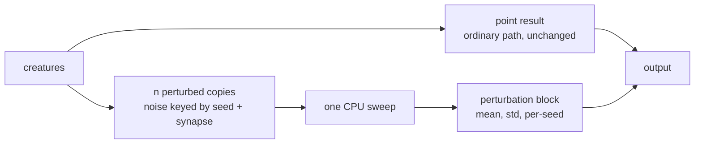

## Summary

Added a perturbation-robustness mode: `--perturb-sigma σ [--perturb-seeds n]
[--perturb-seed-base b]` scores `n` copies of each creature with synapse
weights perturbed by `N(0, σ²)`, under seeds shared by every creature, and adds
the mean and standard deviation of error and score alongside the unchanged
point result. Part of #588.

- [x] Scorer supports a perturbation mode with fixed shared seeds and reports
  mean/σ alongside the point score.
- [ ] σ calibration documented against the production weight distribution —
  method documented and illustrated on the production-scale synthetic fixture;
  the production weights are private (see Limitations).
- [ ] One measurement published: of the last N fleet accepts, how many survive
  perturbation — needs the private fleet accepts (see Limitations).

## Spec

### Intent and Rationale

- Fleet wins are ≈ 6e-05; this lets a consumer tell a flat win from a
  knife-edge one by scoring the ES-smoothed objective `E[f(θ + σε)]`, at the
  authoritative step only.

### Essential Design Decisions

- **Unperturbed result unchanged.** The point result is computed on exactly
  the path it takes without the flag (single-creature path, or directory mode
  with its GPU routing); the perturbed copies are a second, CPU-only sweep. A
  combined sweep would change directory mode's per-worker partition and move
  the point scores by `f32` rounding.
- **Common random numbers by synapse identity.** Copy `k`'s noise on a synapse
  is `N(0, 1)` from Box–Muller over SplitMix64 keyed by `(seedBase + k, from,
  to, role)` — not by position — so every creature gets the same seeds and two
  creatures sharing a synapse get the same noise on it regardless of synapse
  order. Pairing is tested (an identical twin gets bit-identical perturbed
  errors; a synapse-reordered copy matches to `f32` rounding).
- **In-memory scoring.** `multi_score::score_from_creature_dir_cpu` was split
  so its sweep (`score_loaded_creatures_cpu`) takes loaded creatures; the
  perturbed copies are never written to disk and all `n × creatures` of them
  share one corpus pass.
- **Output.** `ScoreResult` gains an optional `perturbation` field, skipped
  when absent, so every other run's JSON is byte-for-byte as before. Standard
  deviations are sample (`n − 1`) estimates; per-seed values are included so a
  caller can pair them across candidates itself.
- Only weights are perturbed, per the issue; biases are untouched.
- Rejected with `--race-stdio`, `--cohort` and `--gpu on`.

### Undiscoverable Facts

- The production creature and fleet accepts are private and not reachable from
  this repository, so the two measurement criteria cannot be met here.
- Built and tested with stable 1.97 (`--ignore-rust-version`); the pinned 1.99
  toolchain is not installable on this host. CI builds with the pin.

## Evidence

σ sweep on the production-scale synthetic creature (2 511 inputs, 7 804
non-input neurons, 65 687 synapses; RMS weight 0.299, median |w| 0.248), 4 000
records, 8 seeds, release build:

| σ | point error | mean perturbed error | std error |
| ---: | ---: | ---: | ---: |
| 1e-4 | 1.366576 | 1.366558 | 6.0e-04 |
| 1e-3 | 1.366576 | 1.366416 | 6.0e-03 |
| 1e-2 | 1.366576 | 1.366888 | 5.9e-02 |

`stdError` is linear in σ, as expected for small σ. The fixture is a random
network (its error is high), so these figures illustrate the calibration
method only.

## Acceptance Criteria

- **met** — perturbation mode with fixed shared seeds, mean/σ alongside the
  point score.
- **missing** — σ calibration against the production weight distribution.
  — reason: production weights are private; the method is documented and
  `weightRms`/`weightMedianAbs` are reported for it.
- **missing** — measurement of how many recent fleet accepts survive
  perturbation. — reason: needs the private fleet accepts and corpus.

## Test Plan

- `cargo test -p rust_scorer --lib perturb` — 4 tests: noise is a pure
  function of seed and `(from, to, role)` (independent of weight), standard
  normal over 20 000 draws (mean and std within 0.03), spec rejects bad σ and
  seed counts, sample std estimator.
- `cargo test -p rust_scorer --test perturb_mode` — 3 tests: directory results
  identical to a plain run apart from the new block (and absent without the
  flag); block shape, mean consistency and positive spread; twin bit-identical,
  reordered within `f32` rounding, other creatures different; single-file mode
  unchanged point result, determinism, seed-base sensitivity, σ → 0 recovers
  the point error, larger σ widens the spread; seven refusals each asserted
  by its stderr message (σ ≤ 0, `--perturb-seeds 0`, seeds without σ,
  `--cohort`, `--race-stdio`, and `--gpu on` before adapter selection).
- Full workspace fmt, clippy (`-D warnings`, `filter_next`, `collapsible_if`),
  tests, rustdoc `-D warnings`, codespell, `markdownlint-cli2` and every
  `scripts/check-*.sh` validator — all pass.

## Security Check

No `unsafe`, no new dependency, no workflow change. Perturbed copies live only
in memory; input creatures are never modified.

## Limitations

The two measurement criteria need the private production creature and fleet
accepts: run `--perturb-sigma` at a few multiples of the production
`weightMedianAbs` on the last N accepted creatures and their parents, and count
how many keep their win on `meanScore`.
