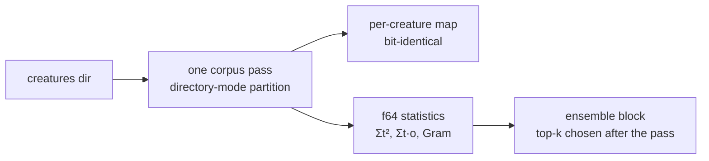

## Summary

Added `--ensemble mean [--ensemble-top-k N]`: a creatures directory is scored
in the ordinary single corpus pass, the per-creature results stay bit-identical
to plain directory mode, and an `"ensemble"` block reports all three terms of
the Krogh–Vedelsby decomposition for the uniform mean prediction. Closes #589.

- [x] `--ensemble mean` scores the element-wise mean prediction over a creature
  directory, in the existing single corpus pass.
- [x] `--ensemble-top-k N` restricts membership to the N lowest-error members.
- [x] Output carries `meanMemberError`, `ensembleError`, `ambiguity` and
  `bestMemberError` (plus `members`, `memberKeys`, `beatsBestMember`).
- [x] Unit test asserting `ambiguity == meanMemberError − ensembleError` on a
  hand-computable fixture.
- [x] Unit test asserting `ensembleError <= meanMemberError` for deliberately
  disagreeing members.
- [x] Forward-only creatures only; recurrent members rejected outright.

## Spec

### Intent and Rationale

- The population beyond the champion is discarded; this measures whether
  averaging it would beat the champion, by reporting the diversity term `Ā`
  rather than guessing at it.

### Essential Design Decisions

- **Per-creature outputs without a second forward pass or drift.** Outputs come
  from `neat-core`'s public `CompiledNetwork::score_records_flat_into`, driven
  so each record lands in the same SIMD tier the fused MSE scan gives it in a
  worker range — 8-record groups; the 4-record group as an 8-group padded with
  copies (lanes are independent); the `n % 4` tail one record at a time — over
  directory mode's own worker partition, with squared error folded in record
  order. The per-creature map is therefore bit-identical to plain directory
  mode (tested over every tier and multi-file corpora).
- **Top-k in one pass.** Membership by own full-corpus error is only known at
  the end, so the pass keeps per-output sufficient statistics for every subset:
  `Σ t²`, `Σ t·oₐ` and the Gram matrix `Σ oₐ·o_b`. `SSE(S) = Σt² − (2/K)Σ Σt·oₐ +
  (1/K²)ΣΣ oₐ·o_b`. Cost is `members²` multiply-adds per record per output,
  small next to a forward pass; partial statistics per thread are merged in
  order.
- **One arithmetic for the decomposition.** `meanMemberError`,
  `bestMemberError` and `ensembleError` all come from those `f64` statistics,
  and `ambiguity` is defined as `meanMemberError − ensembleError`. Mixing in the
  per-creature `error` (which takes the `f32` difference first, as directory
  mode does) left a one-member ensemble with ~-1e-10 ambiguity — found by the
  disagreeing-members test and fixed this way, so a negative ambiguity is a
  genuine bug signal.
- **Flag conflicts are refused in `gpu_plan::validate_ensemble_flags`**, beside
  the `--cohort` and `--race-stdio` checks and before adapter selection, so
  `--ensemble --gpu on` names the conflict even on a GPU-less host and
  `--ensemble --creature-stdin` is refused rather than silently ignored.
- **Output shape.** The stem-keyed map gains one `"ensemble"` key; a creature
  named `ensemble.json` is rejected rather than silently shadowed. No `score`,
  no weighting, no promotion path, as the issue scopes it.
- Built on the shared `finalise_directory_results` from #683 (merged).

### Undiscoverable Facts

- The production population is private; no measurement on it is included. The
  issue's own arithmetic (`Ā > 2.04e-04` needed to beat the champion) is the
  experiment a consumer can now run.
- Built and tested with stable 1.97 (`--ignore-rust-version`); the pinned 1.99
  toolchain is not installable on this host. CI builds with the pin.

## Evidence

## Acceptance Criteria

- **met** — every item in the issue's acceptance list (see Summary).

## Test Plan

- `cargo test -p rust_scorer --lib ensemble` — 5 tests (4 in `ensemble`, plus
  `gpu_plan`'s `ensemble_flag_conflicts_are_refused_before_adapter_selection`): hand-computed
  decomposition (members at `t ± 1`: `Ē = 1`, `E = 0`, `Ā = 1`, identity exact);
  six disagreeing members, every `k`: `ensembleError ≤ meanMemberError`, Gram
  form equal to a direct average within 1e-12, positive ambiguity; top-k picks
  the lowest-error members and rejects `0` and `> members`; merged partial
  statistics equal one pass.
- `cargo test -p rust_scorer --test ensemble_mode` — 4 tests: per-creature
  `error`/`score` bit-identical to directory mode for aggregate-squash
  populations (graft cohort with `IF`, `MINIMUM`/`MAXIMUM` creatures —
  neat-core's per-lane path) **and** standard-squash-only populations
  (neat-core's interleaved path), 1 and several members, corpora of 1, 3, 4,
  6, 12, 13+7 and 517+5+1000 records (scalar-only ranges, a lone 4-group, a
  4-group after an 8-group, tiles, multi-file); identity, `ambiguity ≥ 0`, zero
  ambiguity for one member; CLI on constant predictors `+1, −1, +3` against
  target `0` (`Ē = 11/3`, `E = 1`, `Ā = 8/3`, top-2 perfect, no `score` key);
  nine refusals each asserted by its stderr message; recurrent member
  rejected; a creature named `ensemble.json` refused with its collision
  message, from the library and the CLI.
- Full workspace fmt, clippy (`-D warnings`, `filter_next`, `collapsible_if`),
  tests, rustdoc `-D warnings`, codespell, `markdownlint-cli2` and every
  `scripts/check-*.sh` validator — all pass.

## Security Check

No `unsafe`, no new dependency, no workflow change. The new path reads
creatures and corpus exactly as directory mode does.

## Limitations

Uniform mean only; `MSE` only; forward-only only; CPU only. With many
members the Gram statistics grow as `members² × outputs` (≈ 2 MB at 500
members, one output).
