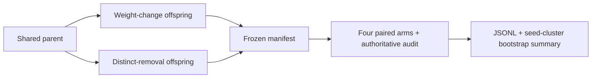

## Summary

Adds a public **near-clone stress profile** to the opt-in cached-halving
experiment that PR #681 delivered, and records its frozen, paired run. The
profile is a population of distinct one-mutation offspring of one shared
parent, so the candidates are near-ties and there is no oracle. The existing
`tree-oracle` fixture is deliberately easy and could not show a lost winner.
Result: cached and nested screening kept every full-data winner, and caching
changed no promotion decision. The stride control lost the winner in 2 of 12
case/seed pairs at the 2% rung (relative regret 0.64% and 1.20%, both above the
predeclared 0.1%). Validation on representative populations is still
outstanding: it needs private candidate populations and corpora that this
public repository and this host do not hold. Part of #680.

- [x] Verify the merged harness (PR #681) and the outstanding scope.
- [x] Add the near-clone profile and the driver flag, with tests.
- [x] Run the frozen protocol, archive the manifest and observations, and document them.
- [x] Fix duplicate candidates found in review, re-run, and disclose the discarded run.
- [ ] Representative-population validation (private inputs, not available here).

## Spec

### Intent and Rationale

- The scientific risk is losing a near-tied winner on a 2%–15% screen. The
  merged fixture has one clear winner, so it cannot measure that. Offspring of
  one parent are the public, application-agnostic shape of that risk.
- The profile is a second public synthetic profile built on the existing
  `cohort_fixture` generators. It is not a new scoring path.

### Essential Design Decisions

- `--fixture-profile` defaults to `tree-oracle`, and its output is byte-identical
  (the code was moved, not rewritten). The flag is only accepted with
  `--generate-fixture`. The driver's `--synthetic-profile` is refused together
  with `--config`.
- Removal offspring drop **distinct** hidden neurons, from the layer set that
  the new shared `cohort_fixture::removable_layers` defines. Generation fails
  loudly on a shortfall or on duplicate rendered candidates.
  `removal_cohort`'s RNG sequence is unchanged.
- Every near-clone case is labelled `kind: synthetic`, so the driver verdict
  stays `inconclusive-no-representative-validation`. No threshold, rate or
  limit was changed.
- The harness is kept, not removed. A representative run (private `--config`)
  still needs it, it is opt-in, and it changes no scorer default.

### Undiscoverable Facts

- A first near-clone run (tip `44b49ba`) used `removal_cohort`, which draws with
  replacement. 3 of the 4 cases held byte-identical candidates, and that run
  showed cached/nested losing a winner on validation-24. Review found the
  duplicates. The run was discarded as an invalid population, and the re-run
  used the same case seeds. This is disclosed in `docs/experiments/halving.md`.
- This host has no training corpora (`find` over `/home/vibe` and `/var/tmp`
  found no `.bin` over 1 MiB outside build directories), and
  `BENCH_PROD_CREATURE` was unset.
- The evidence is single-host only, from `vibe-coder-7723` (Linux/aarch64), and
  the timings are indicative.

## Evidence

- Frozen manifest `docs/evidence/issue-680-near-clone-manifest.json` and raw
  observations `docs/evidence/issue-680-near-clone.jsonl.gz`. Commands:
  `python3 -B scripts/bench-halving.py prepare --synthetic-root <dir>/inputs
  --synthetic-profile near-clone --manifest <dir>/manifest.json`, then
  `run --manifest … --results …`. Driver output:
  `inconclusive-no-representative-validation; 96/96 trials`.
- 96 of 96 trials succeeded, with no integrity error. Every case had pairwise
  distinct candidate SHA-256s (12/12, 24/24, 12/12, 24/24).
- Each case/seed outcome was identical across its 8 repetitions. The largest
  surviving full-result deviation was `2.02e-10`, inside the 1e-6 tolerance.
- Cached scoring used 79.8–83.4% fewer evaluations than full and 19.1–19.9%
  fewer than nested uncached. 13,912,176 record evaluations were made in total,
  including the audits.
- Regenerating the profile from the final head reproduced every recorded
  candidate and corpus hash (`identical`).
- #680: Experiment: Benchmark shared-core cached successive-halving evaluation.

This is backend/CLI and research tooling. No visual surface changed.

## Acceptance Criteria

<!-- vibe-spec-review inputs="diff+issue-body" -->

- **partial** — Compare current screening and full evaluation with cumulative deterministic strata at 2%, 5%, 15%, 100%, sharing record IDs between candidates. Reuse sufficient statistics only for decomposable canonical costs; evaluate only unseen records and match exact full results within documented numeric tolerance. Audit rejected candidates to measure lost full-data winners. Count all record evaluations, cache costs and wall time. Reuse existing progressive screening where possible and keep final full scoring authoritative. — evidence: `docs/experiments/halving.md` near-clone section, `docs/evidence/issue-680-near-clone.jsonl.gz` — reviewer: partial — reason: the comparison has only run on synthetic fixtures; representative populations and corpora are private and not on this host.
- **met** — First inspect current code, merged work and repository instructions. Reuse existing mechanisms; if functionality already exists, this issue still owns the missing controlled comparison rather than a second implementation. — evidence: `rust_scorer/src/halving_experiment.rs::write_near_clone_case` calls `cohort_fixture` helpers, including the new shared `removable_layers` — reviewer: partial — reason: the reviewer flagged the removable-layer policy copied from `removal_cohort`; after that review it moved into `cohort_fixture::removable_layers`, which both callers use.
- **met** — Opt-in experiment only; preserve ordinary behaviour, interfaces, immutable parents and full authoritative acceptance. No automatic deployment or default change. — evidence: `rust_scorer/src/halving_experiment.rs` (`FixtureProfile::TreeOracle` default, `requires = "generate_fixture"`) — reviewer: met
- **partial** — Predeclare controls, seeds, sample size, compute limits and success/failure criteria. Identify code/model/data versions; separate calibration from untouched validation and count all preparation/search costs. — evidence: `docs/evidence/issue-680-near-clone-manifest.json` — reviewer: partial — reason: everything is frozen and the discarded first run and its cost are now disclosed, but this profile's validation parents and corpora were observed once before the generator fix.
- **met** — Provide deterministic positive/negative correctness tests for new behaviour and pass the repository's normal quality checks. Research runs are separate from routine feature CI. — evidence: `rust_scorer/tests/halving_bench_cli.rs::near_clone_fixture_writes_offspring_of_one_parent_and_scores_authoritatively`, `rust_scorer/tests/halving_bench_cli.rs::driver_passes_near_clone_profile_through_and_refuses_it_without_synthetic_root`, `rust_scorer/src/halving_experiment.rs::near_clone_tests::near_clone_rejects_too_few_removable_neurons_before_writing`; `./quality.sh` exit 0 on the final head — reviewer: met
- **met** — Deliver a reproducible command/manifest and machine-readable results with paired distributions, uncertainty, failures and actual coverage. Fixtures alone do not demonstrate an optimisation benefit. — evidence: `docs/experiments/halving.md`, `docs/evidence/issue-680-near-clone-manifest.json`, `docs/evidence/issue-680-near-clone.jsonl.gz` — reviewer: met
- **met** — Record negative findings and remove optional code that does not earn its maintenance cost. Do not claim success before representative runs. — evidence: `docs/experiments/halving.md` near-clone verdict, `CHANGELOG.md` — reviewer: met
- **met** — Keep public implementation and fixtures application-agnostic; private corpora/results and operational integration remain private. — evidence: `rust_scorer/src/halving_experiment.rs::write_near_clone_case` (generic layered networks, sine-target corpus) — reviewer: met
- **met** — Leave unassigned until an implementer actively starts. `work-on` authorises the investigation, not skipping prerequisite verification. — evidence: this run first verified merged PR #681 and the host's inputs before changing anything — reviewer: missing — reason: the reviewer said "not assessable from a diff (process criterion); nothing in the diff contradicts it".

## Standards Review

<!-- vibe-standards-review inputs="diff+CODING-STANDARDS.md" -->

- **clean** — The repo has no `CODING-STANDARDS.md`, so `CONTRIBUTING.md` and `AGENTS.md` were used; neither marks any rule as review-only. Checked and compliant: Australian English; the positional CLI contract; tests run the real binary and driver; creature JSON comes from `fixture_json` (no hand-encoding); no `unsafe`; CHANGELOG under `[Unreleased]`; docs cross-references resolve; no named-but-absent tests; no workflow change. No existing test expectation was changed (`rust_scorer/tests/halving_bench_cli.rs` is append-only). Optional, not chased: a doc-comment line over 80 columns in `rust_scorer/src/cohort_fixture.rs`, and one multi-concern test.

## Test Plan

- `rust_scorer/tests/halving_bench_cli.rs::near_clone_fixture_writes_offspring_of_one_parent_and_scores_authoritatively`
  (new) covers:
  - case ids, population sizes and corpus byte sizes (12 inputs + 2 outputs);
  - pairwise-distinct candidates, and a shared-parent shape (half with N
    neurons, half with N − 1);
  - a real worker run with four arms within 1e-6 and non-equal authoritative
    errors;
  - refusal of `--fixture-profile` without `--generate-fixture` (stderr names
    the requirement);
  - refusal of an existing root (marker file survives, diagnostic names
    `create synthetic root`).

  The distinctness assertion was observed failing against the with-replacement
  generator (`calibration-24: duplicate candidates`) and passes after the fix.
- `rust_scorer/tests/halving_bench_cli.rs::driver_passes_near_clone_profile_through_and_refuses_it_without_synthetic_root`
  (new) runs the real driver. Pass-through: the manifest names the
  near-clone split justification, and the data size tells the profiles apart.
  Refusal: `--config` together with `--synthetic-profile` exits non-zero with
  the reason, and no manifest is written.
- `rust_scorer/src/halving_experiment.rs::near_clone_tests::near_clone_rejects_too_few_removable_neurons_before_writing`
  (new): population 60 is refused with "distinct removable neurons" and nothing
  is written; population 24 is the positive control and writes 24 files. The
  duplicate-render guard cannot be reached at the shipped sizes and has no
  test.
- The `removal_cohort` refactor keeps the draw sequence: `cohort_parity` (12)
  and `cohort_parity_workers` (1) passed, and so did the `cohort_fixture` lib
  tests (3).
- `timeout 1500 ./quality.sh < /dev/null` on the final head: exit 0, "All
  quality checks passed!". The run included `halving_bench_cli` (8 passed) and
  the Python driver contracts.
- Existing tests: none edited, and no assertion was removed.

## Limitations — not done

- Representative-population/corpus validation was not run: the private inputs
  are unavailable here, and the issue requires them to stay private.
- There was no quiet-host timing and no macOS run. Three seeds and one
  population per size give limited uncertainty resolution.
- The duplicate-render guard is untested (unreachable at the shipped sizes).
