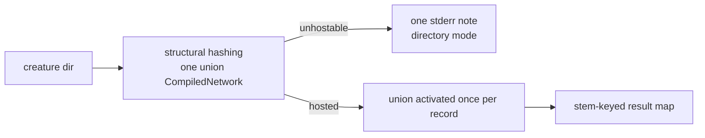

## Summary

Added `--cohort`: directory mode builds one union network in which every
computation the creatures share appears once, and activates it once per record,
so a near-clone of an incumbent costs only its dirty cone. Each creature's
result is bit-identical to scoring it alone in a directory. On a
production-scale synthetic creature at 200 MB, the 64-graft cohort ran in
**8.3 %** of directory mode's wall time (bar: ≤ 25 %). Closes #683.

- [x] Parity tests: cohort versus standalone on graft, weight-change and
  removal cohorts, including `IF`, `MINIMUM` and `MAXIMUM` aggregates and
  constant neurons.
- [x] Bench on the production-scale fixture for the three cohort shapes,
  reporting neuron activations per record and wall time against directory mode.
- [x] Predeclared success: the 64-graft cohort at most a quarter of directory
  mode's wall time on the same host — met at 8.3 %.
- [x] CPU first. No GPU hosting.

## Spec

### Intent and Rationale

- Every optimiser asks about near-clones of one incumbent; directory mode pays
  a full forward pass per candidate per record. Cohort mode pays once for what
  the cohort shares.
- Complements #680 (fewer records per candidate): this reduces neurons per
  record per candidate. The two multiply.

### Essential Design Decisions

- **Structural hashing in the scorer** (`rust_scorer/src/cohort.rs`). A
  constant is keyed by its bias; a computed neuron by squash, bias and the
  ordered inbound list `(union source id, weight bits, role)`. Compiled
  networks are topological, so mapping each neuron's sources to union ids
  before hashing decides recursive equality in one pass. Floats compare by bit
  pattern (`0.0` ≠ `-0.0`, tested). No UUID and no caller-supplied diff is
  consulted. Inbound order is part of the key because it is part of the `f32`
  summation.
- **Bit-identical by construction.** The union is a real `CompiledNetwork`
  (`from_parts` validates the index invariants the unchecked kernels need). It
  is evaluated with the public `neat-core` kernels in the fused MSE scan's
  per-record arithmetic: records in a 4-or-more SIMD group go through
  `weighted_sum_interleaved_unchecked` + `squash_xn` + the range clamp; the
  `n % 4` tail through `weighted_sum_simd_unchecked` and the single-record
  aggregate rule; squared errors fold into `f64` in record order. Chunks are
  partitioned as directory mode partitions a one-creature directory. The only
  mirrored upstream code is `inline_squash` (crate-private upstream, four
  lines) and the `MINIMUM`/`MAXIMUM`/`IF` loops; the parity tests break if they
  drift.
- **Hosted scope.** `MSE`/`RMSE`, forward-only creatures, no
  `HYPOT`/`HYPOTv2`/`MEAN` (their single-record SIMD kernels need a per-record
  activation slice), union ≤ 65 536 nodes. Anything else is refused before the
  corpus is opened, and the CLI scores it on today's path (GPU routing
  included) after exactly one `[cohort] fallback to directory mode: <reason>`
  stderr line.
- **Opt-in flag**; stdout map and exit codes unchanged. One stderr line on
  success reports activations and synapses per record against directory mode.
  `--cohort` is rejected with `--race-stdio`, `--gpu on` and single-file input.
- The per-creature finalisation in `multi_score` was extracted into
  `finalise_directory_results` so the directory and cohort sweeps share it.
- Not built: optional item 3 (incremental aggregates). The public interleaved
  kernel seeds every lane with one scalar bias, so continuing per-lane partial
  sums would need a second FMA chain with no rounding guarantee; the bar was
  met without it.

### Undiscoverable Facts

- The production creature is private and never fetched. The bench uses
  `LayeredShape::production_scale` (2 511 inputs, 7 804 non-input neurons,
  65 687 synapses, a fan-in-1 500 anchor), sized to the issue's figures.
- This host could not install the pinned 1.99 toolchain (the Rust dist server
  is not reachable from it); everything here was built and tested with stable
  1.97 and `--ignore-rust-version`. CI builds with the pin.

## Evidence

Host: x86_64 Linux container, Intel Xeon @ 2.10 GHz, 2 logical CPUs, 7 GiB
RAM, no GPU. Release build. 200 000 000 B corpus (19 904 records, four files).
Six alternating directory/cohort runs per shape. Raw results:
`docs/evidence/issue-683-cohort-bench.jsonl`.

```bash
BENCH_SCORING_BYTES=200000000 ./target/release/cohort_bench --repeats 6
```

| Cohort | Activations / record, directory → cohort | Directory wall, median [95 % CI] | Cohort wall, median [95 % CI] | Cohort / directory |
|---|---|---|---|---:|
| 64 grafts at one anchor | 499 611 → 8 083 | 47.72 s [46.79, 49.11] | 3.96 s [3.70, 4.49] | **8.3 %** |
| 100 single-weight changes | 780 400 → 8 892 | 20.73 s [19.60, 21.40] | 5.91 s [5.65, 6.34] | 28.5 % |
| 100 single-neuron removals | 780 300 → 8 657 | 21.18 s [20.46, 22.72] | 6.14 s [5.92, 6.37] | 29.0 % |

Brackets are distribution-free 95 % intervals of the median
(`bench_support::median_ci95`; with six runs, the full range at 96.9 %
coverage). They do not overlap in any shape. At this scale cohort wall time is mostly loading 64–100 creature files
of ≈ 5 MB; the forward pass is ≈ 1 % of directory mode's, so the weight and
removal ratios are a loading floor. Graft creatures carry `IF`, which puts
directory mode on `neat-core`'s per-lane aggregate path — hence its slower
64-creature run. Largest relative error difference against the multi-creature
directory run: 3.8e-10.

This is a new mode measured against the path it replaces on identical inputs,
rather than a Criterion A/B of an existing bench: a production-scale directory
run takes ≈ 20–50 s, below Criterion's useful sample floor on this host. The
dedicated bench reports exactly the metrics the issue asks for.



## Acceptance Criteria

- **met** — parity tests on graft, weight-change and removal cohorts, with
  `IF`, `MINIMUM`, `MAXIMUM` and constant neurons, reusing the #574 `IF` tree
  fixtures.
- **met** — bench on the production-scale fixture for all three shapes,
  activations per record and wall time against directory mode.
- **met** — 64-graft cohort at 8.3 % of directory mode's wall time (≤ 25 %).
- **met** — CPU only; GPU hosting left as a follow-up the result could justify.

## Test Plan

- `cargo test -p rust_scorer --test cohort_parity` — 12 tests: graft,
  weight-change, removal and unrelated cohorts bit-identical (`error`, `score`,
  `complexityPenalty`, counts) to each creature scored alone, over corpora of
  1, 3, 4+3, 7+37 and 517+5+1000 records (every SIMD tier, multi-file); exact
  candidate ordering; drift against a multi-creature directory run equals
  directory mode's own drift and stays within 1e-6; sampled corpus
  (`--sample-rate 0.37`, phase 3); `RMSE`; union sizes (graft pays only `IF`
  neurons, anchor and outputs; identical creatures share everything; `-0.0`
  is a distinct weight); refusals for `MAE`, `HYPOT`, recurrent (before any
  corpus read); CLI hosted line, single fallback line with output equal to
  plain directory mode; `--cohort` refused with a single file, `--gpu on`,
  `--race-stdio` and `--creature-stdin`, each by its stderr message and before
  adapter selection.
- `cargo test -p rust_scorer --lib bench_support cohort_fixture` — the median
  interval's ranks pinned for n = 5 (none), 6 and 8 (full range), 9 (2nd–8th)
  and ≥ 95 % coverage for n = 6..60; the production-scale fixture's 7 804
  neurons, 65 687 synapses and fan-in-1 500 anchor; an impossible fan-in is
  refused rather than clamped.
- `cargo test -p rust_scorer --test cohort_bench_smoke` — the bench on the
  small shape: three cohorts, real intervals at 6 runs, `null` below 6, refused
  bad flags.
- `cargo test -p rust_scorer --test cohort_parity_workers` — the #574 `IF`
  tree fixtures (grafted, ungrafted, mixed, depth 1–3 trees, boundary records)
  under `NEAT_SCORER_ACTIVATION_THREADS=5`, bit-identical to standalone.
- Full workspace: `cargo fmt --check`, `cargo clippy --workspace --all-targets
  --all-features -- -D warnings -D clippy::filter_next -D
  clippy::collapsible_if`, `cargo test --workspace --all-features`,
  `RUSTDOCFLAGS=-D warnings cargo doc`, codespell, `markdownlint-cli2`, and
  every `scripts/check-*.sh` validator — all pass.

## Security Check

The new `unsafe` calls reach `neat-core`'s unchecked kernels on a union built
by `CompiledNetwork::from_parts`, which validates every source index and
synapse span; scratch lengths are guarded by always-on `assert!`s. No new
dependency, no workflow change, no network access.

## Limitations

The fixture is synthetic at production size, not the production creature.
Numbers are from a 2-CPU shared container. Cohorts whose union exceeds 65 536
nodes (e.g. many unrelated large creatures) fall back rather than being split
into sub-cohorts.
