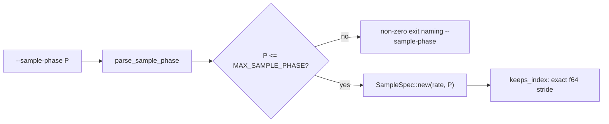

# PR summary — Issue #685

## Summary

`--sample-phase` is now bounded to `[0, 2^32-1]` (`MAX_SAMPLE_PHASE`). Before
this change `SampleSpec::new` checked only the rate. A larger phase pushed the
`f64` stride index `i + phase` past the range where `f64` holds every integer
exactly, so the sampler silently kept a skewed subset or no records at all. At
`u64::MAX` the index addition overflowed. `SampleSpec::new` now rejects such a
phase with an error naming `--sample-phase`. The CLI parses the flag through a
new `parse_sample_phase` value parser, which calls `SampleSpec::new`, so every
out-of-range phase exits non-zero, whether or not `--sample-rate` is given.
Closes #685.

## Spec

### Intent and Rationale

- I rejected out-of-range phases rather than rewriting the stride in integer
  arithmetic. The `f64` predicate `floor((j+1)·rate) > floor(j·rate)` must keep
  matching the TypeScript consumer (NEAT-AI#3257) record for record. An integer
  rewrite could disagree with it on rounding at ordinary phases.

### Essential Design Decisions

- I chose the bound `2^32-1`, the same limit PR #681's halving bench already
  enforces on `--seed`. It keeps `phase + record index` far below 2^53 for any
  corpus a host can hold, and makes the `u64` addition unable to overflow. The
  halving bench now reads the shared `MAX_SAMPLE_PHASE` instead of its own
  `u32::MAX as u64` literal. Its error text is unchanged, because
  `rust_scorer/tests/halving_bench_cli.rs` asserts it.
- The phase is range-checked even when `--sample-rate` is `1` or absent. In
  that case it still has no effect on scoring. Rejecting it means a caller that
  passes a 64-bit hash or seed learns about the problem straight away, instead
  of only once it turns sampling on.
- `parse_sample_phase` delegates to `SampleSpec::new`, so the range check has
  one source of truth, just as `parse_sample_rate` does for the rate.

### Undiscoverable Facts

- I checked the base binary with 100 records at `--sample-rate 0.5`. Phase
  `4294967295` gave `recordCount 50`. Phase `9007199254740992` (2^53) gave
  `recordCount 25` with exit 0, a silent skew. Phase `18014398509481984` (2^54)
  failed with `Error: No training records found`. Phase `18446744073709551615`
  panicked with `attempt to add with overflow` at `rust_scorer/src/sampling.rs:198`.
- Assumption: no caller relies on a phase above 2^32-1. The TypeScript consumer
  rotates the phase per generation. I could not inspect its code from this
  repository.

## Evidence

This is a CLI and library change only. The tests are listed in the Test Plan.

## Test Plan

- Added `rust_scorer/src/sampling.rs::tests::spec_rejects_phase_beyond_exact_stride_range`.
  `MAX_SAMPLE_PHASE` is accepted, as the control. `MAX_SAMPLE_PHASE + 1`, 2^53,
  2^54, 2^60 and `u64::MAX` are each refused with a message naming
  `--sample-phase`. Every case uses a valid rate, so only the phase rule can
  refuse it.
- Added `rust_scorer/src/sampling.rs::tests::largest_phase_still_keeps_the_expected_fraction`.
  With 2,048 records at the largest phase, rate 0.5 keeps exactly 1,024. Rates
  0.02, 0.05 and 0.15 each keep within one record of `N·rate`. These are the
  rates the issue used. This test is a control and passes on base as expected.
- Added `rust_scorer/src/sampling.rs::tests::parse_sample_phase_validates`. It
  covers the valid values, the boundary, values out of range, a value that
  overflows `u64`, negative input and input that is not a number.
- Added `rust_scorer/tests/sample_rate_tdd.rs::out_of_range_sample_phase_is_rejected`.
  It drives the real binary. Phases 2^32, 2^53, 2^54 and `u64::MAX` each exit
  non-zero with `--sample-phase` on stderr and no panic. A huge phase without
  `--sample-rate` is also refused. The control at `4294967295` scores 50 of 100
  records.
- Red against base: I restored the `origin/Develop` copies of `sampling.rs`,
  `cli.rs` and `halving_experiment.rs` and kept the new test. The test then
  failed with `--sample-phase 4294967296 must fail loud, not keep a skewed subset`.
  After the fix, these all passed: `cargo test --lib sampling` (17), the
  `sample_rate_tdd` tests (6), the `halving_bench_cli` tests (6) and the
  `sampling` doctests (5).
- `./quality.sh < /dev/null` passed on the final code commit:
  `✅ All quality checks passed!`.
- No existing test was edited, and no existing assertion was removed.
- Docs updated: the `--sample-phase` bullet in the README sub-sampling section
  (I read the whole section), the `CHANGELOG.md` `[Unreleased]` → `Fixed`
  section, and the doc comments for the CLI flag, the `sampling.rs` module,
  `SampleSpec::new` and `keeps_index`.

Not done or not checked: I did not inspect the TypeScript consumer's phase
range, which is outside this repository. No other risk remains.

🤖 Generated with [Claude Code](https://claude.com/claude-code)
